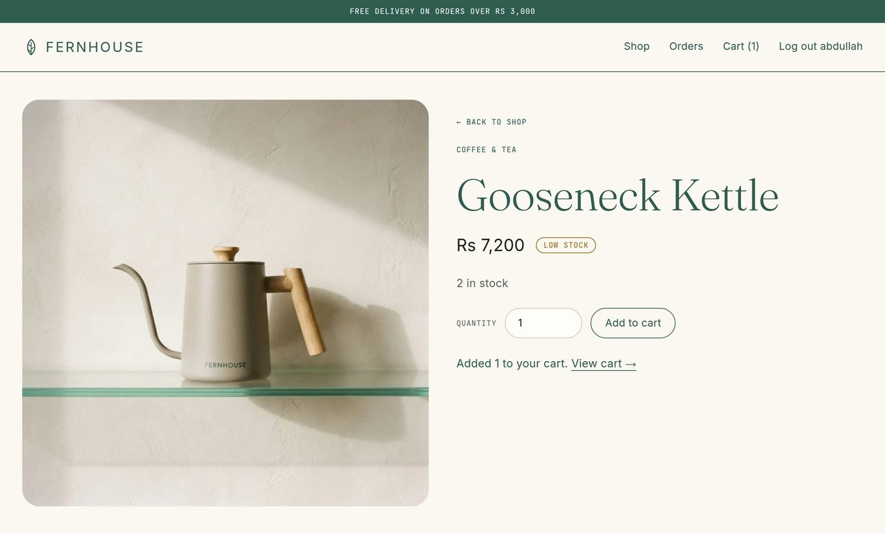
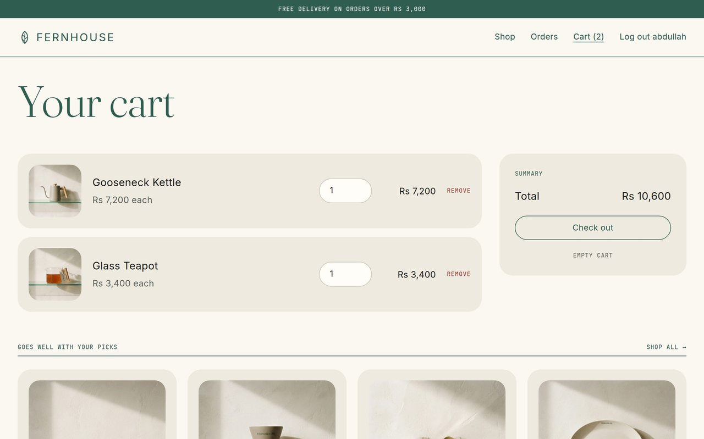
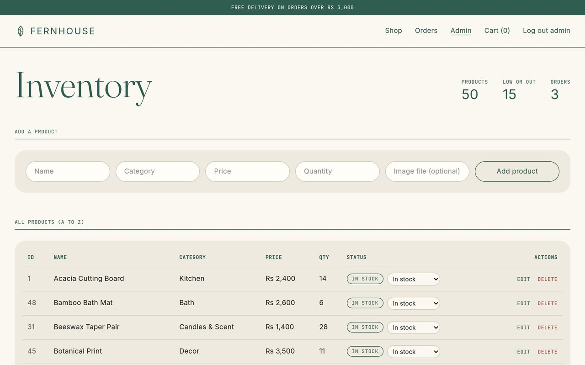

<p align="center">
  
</p>

<p align="center">
  <em>Calm, well made things for the kitchen, the table and the quiet corners of your home.</em>
</p>

<p align="center">
  
  
  
  
  
</p>

<p align="center">
  
</p>

**Fernhouse** is an inventory management system and online homeware store. The Java backend keeps the stock, accounts, carts and orders, and a React website lets customers shop and lets the admin manage the inventory.

## Contents

- [Features](#features)
- [Screenshots](#screenshots)
- [Data structures](#data-structures)
- [Tech stack](#tech-stack)
- [Getting started](#getting-started)
- [Project structure](#project-structure)
- [Tests and documentation](#tests-and-documentation)
- [API](#api)
- [Coding standards](#coding-standards)
- [Authors](#authors)

## Features

**For customers**

- Browse 50 products across 8 categories, or filter by category
- Search as you type by the start of a product name
- Create an account and log in (passwords are stored as SHA 256 hashes)
- Add products to a cart, change quantities and check out
- Get personal recommendations based on what you and other customers bought together
- See your order history

**For the admin**

- Add, view, update and delete products
- Set each product to In Stock, Low Stock or Out of Stock (it also updates on its own when the quantity changes)
- Clear messages for invalid input, such as an empty name or a negative or non numeric quantity
- See every order placed in the store

All data is saved in JSON files, so nothing is lost when the server restarts.

## Screenshots

<table>
  <tr>
    <td width="50%"><p align="center"><sub>Shop with live search</sub></p></td>
    <td width="50%"><p align="center"><sub>Product page</sub></p></td>
  </tr>
  <tr>
    <td width="50%"><p align="center"><sub>Cart with recommendations</sub></p></td>
    <td width="50%"><p align="center"><sub>Admin inventory</sub></p></td>
  </tr>
</table>

## Data structures

| Structure | Where | What it does |
|-----------|-------|--------------|
| **Trie** (prefix tree, children in a `TreeMap`) | `store.ds.ProductTrie` | Every product starting with "a" sits under the "a" node, so searching by the first letters costs the length of the typed text, and results come out A to Z |
| **Hash table** (`HashMap`) | `store.ds.ProductCatalog`, `store.service.UserService` | Instant lookup of products by ID, users by username and sessions by token |
| **Linked list** (`LinkedList`) | `store.model.User`, `store.service.CartService` | Each user's cart: new products go on the end, and adding the same product again raises its quantity |
| **Weighted graph** (adjacency map) | `store.ds.RecommendationGraph` | Products bought in the same order are linked; edge weights count how often, and each user's suggestions add up the weights around what they bought |

## Tech stack

| Part | Tools |
|------|-------|
| Backend | Java 17, the JDK's built in `HttpServer`, Gson for JSON |
| Frontend | React 19, React Router 7, Tailwind CSS 4, Vite 6 |
| Storage | JSON files (`products.json`, `users.json`, `orders.json`) |
| Testing | JUnit 5 |
| Documentation | Javadoc |
| IDE | Visual Studio Code with JDK 17 |

## Getting started

You need **JDK 17** and **Node.js**. Run the backend and the frontend in two terminals.

**Backend** (from `backend/`):

```bash
./run.sh
```

The API starts at `http://localhost:8080/api`. On the first run the starter files in `backend/seed/` are copied to `backend/data/`, which then holds the live data.

**Frontend** (from `frontend/`):

```bash
npm install
npm run dev
```

Then open [http://localhost:5173](http://localhost:5173).

**Admin account:** the starter accounts file `backend/seed/users.json` contains one admin, username `admin` with password `admin123`. Any account becomes an admin when `"admin": true` is set for it in `backend/data/users.json`. Change the password before using the store for real.

## Project structure

```text
.
├── backend
│   ├── src/main/java/store
│   │   ├── api        HTTP routes: products, auth, cart, orders, admin
│   │   ├── data       JSON storage
│   │   ├── ds         Trie, catalogue (hash table) and recommendation graph
│   │   ├── model      Product, User, CartItem, Order, StockStatus
│   │   ├── service    Inventory, accounts, cart, checkout, recommendations, validation
│   │   └── Main.java
│   ├── src/test/java  JUnit tests
│   ├── seed           Starter products and admin account
│   ├── lib            Gson and JUnit jars
│   └── build.sh, run.sh, test.sh, docs.sh
└── frontend
    ├── public         Product images, videos, logo and favicon
    └── src
        ├── components Layout, product card, media and reveal animation
        └── pages      Landing, shop, product, cart, orders, login, admin
```

## Tests and documentation

From `backend/`:

```bash
./test.sh
```

Runs all 30 JUnit tests, covering every case in the lab brief (adding valid and invalid items, viewing, updating, deleting, empty inventory) plus the trie, the graph, the cart, checkout, accounts and recommendations.

```bash
./docs.sh
```

Writes the Javadoc HTML to `backend/docs/`. Open `backend/docs/index.html` in a browser.

## API

| Method | Path | Who | What |
|--------|------|-----|------|
| POST | `/api/auth/register`, `/api/auth/login`, `/api/auth/logout` | anyone | Accounts |
| GET | `/api/auth/me` | user | Current user |
| GET | `/api/products?search=ap` or `?category=Bath` | anyone | List or search products |
| GET | `/api/products/{id}`, `/api/categories` | anyone | One product, all categories |
| GET, POST, DELETE | `/api/cart` | user | View, add to or empty the cart |
| PUT, DELETE | `/api/cart/{productId}` | user | Change a quantity or remove an item |
| POST | `/api/checkout` | user | Buy the cart (reduces stock) |
| GET | `/api/orders`, `/api/recommendations` | user | Order history and suggestions |
| POST | `/api/admin/products` | admin | Add a product |
| PUT, DELETE | `/api/admin/products/{id}` | admin | Update or delete a product |
| PUT | `/api/admin/products/{id}/status` | admin | Set In Stock, Low Stock or Out of Stock |
| GET | `/api/admin/orders` | admin | All orders |

## Coding standards

- PascalCase for classes, interfaces and file names, camelCase for everything else, and UPPER_SNAKE_CASE for constants
- Every file starts with a header naming the file, both authors and its purpose
- Every class, constructor and method has a Javadoc comment with `@param`, `@return` and `@author`; no other comments are used
- Method parameters go on their own lines inside the brackets, grouped by type
- Braces for `if`, `else`, loops and `try`/`catch` go on their own lines
- No trailing whitespace

## Authors

**Abdullah Waleed Ahmed** and **Rehan Haider**

Software Construction, Open Ended Lab, November 2026
